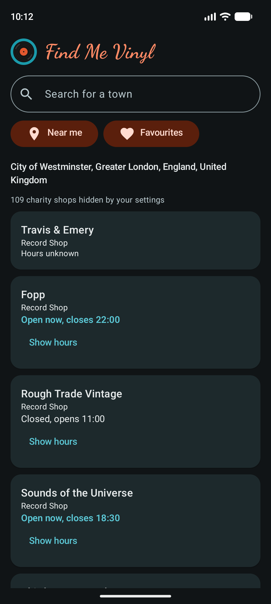

# Find Me Vinyl


An Android app for record collectors. It finds record shops near you, shows an artist's full discography with the formats each album came out on, and keeps your collection and want list on your phone.

It is a hobby project. It has no accounts, no adverts and no server of its own. Everything you choose stays on the phone, and the music data comes from free public sources listed below.

<p>
  
  
  
  
</p>
<p>
  
  
  
</p>

## What it does

- Search for an artist, with suggestions as you type (your favourites first), and see their whole discography, grouped into studio albums, EPs, singles, live albums, compilations and others, with a cover for each. Each row names the artist, and on a group's page it is the member the album is filed under, so you can see which are Nick Cave albums and which are Bad Seeds albums.
- See which formats each album came out on (LP, 12", 7", CD, cassette, digital), and filter by one.
- Mark albums as owned or wanted, or both: an owned copy that is worn out, or a CD you own and want on vinyl, can go on the want list too. Owned albums are teal and wanted ones are orange, and an album that is both stays teal with a Wanted label. A wanted album can be wanted on one format, such as the LP of a record you own on CD. The Wants page and the text you share say which, and the want goes away when you record that format as owned. The Group owned and Group wanted switches put those albums in sections at the top of an artist's discography, Owned first by default. With both on, an arrow on the lower heading moves it to the top. The app remembers the choice for each artist.
- Open an album for its pressings, label and catalogue numbers, tracklist by side, genres and rating.
- Tap the artist's name on an album's page to go back to the artist.
- On an album you own, list the copies you have, each with a format and a note of its own, such as a CD that was part of your mother's collection, or two LPs with green and blue sleeves. You can add as many as you like, even on the same format. On the artist's page each copy has its own line under the album, such as "LP: Green cover", and a want for another format shows as "Wanted on CD". Your copies are kept in backups. You can also choose which of an album's MusicBrainz pressings is yours ("This is my pressing"): the album page then opens on it, with its country, label and tracks, and marks it as yours in the list of pressings.
- Show your favourite artists as a list, or as a grid of pictures when there are many, and the app remembers which you chose. In the grid, each picture has the artist's name under it, a touch opens the artist, and holding a picture then dragging it changes the order.
- Keep a list of favourite artists and a want list in the order you choose, and share the want list as text. Before sharing you can add a message ("It's my birthday soon, here are some ideas") and choose how many albums to send, such as the top 10 or top 20, so the list is not too long.
- Add your own photo for an artist when the one from the web is poor or missing.
- Each favourite artist and group is given the genre with the most votes on MusicBrainz, found in the background, one a second. If you disagree, choose another from the genres MusicBrainz lists for it or type your own. Your choice is kept for good and is in backups, and taking it away goes back to the suggestion. The Artists page can then group your favourites by genre, in the list and in the grid, with a heading for each genre and one for artists with no genre yet. The Wants page is not affected.
- Join artists that belong together into a group under a name of your own, such as Nick Cave and Nick Cave & The Bad Seeds. From an artist's page, Join with another artist lets you search for the others and name the group, and the favourites then show the group in place of its artists. Splitting a group up puts everything back as it was. The want list and the text you share from it list a group's wanted albums under the group's name, and typing in the artist search finds a group by the name of any of its artists. Opening a group shows the albums of all its artists together, with the same Group owned, Group wanted and format filters, and a photo of its own that you can change (it starts with the first artist's).
- Find record shops, charity shops and second hand shops near you or in a town you type (towns are suggested as you type), with their opening hours and whether they are open now, taking public holidays into account. Tap a shop for its page: address, phone, website, email and the hours of every day of the week, with a button to open it on a map. Keep the shops you like as favourites, listed by town, to find them again without a search. Add a shop that the map does not have by sharing it from Google Maps into the app, or by typing it in. Opening hours can be typed in plain words, such as Mon-Sat 10-7, and a shop you added can be edited later. A shop added from a Google Maps link has a button to open its page in Google Maps, for the hours, photos and reviews.
- Hide what you do not want to see: live albums, compilations, singles, particular formats, bootlegs, promos, releases with an unknown status, charity shops and second-hand shops.
- Back up your data (artists, groups of artists, albums, photos, favourite shops and settings) to a zip file and restore it later, for example on a new phone.

## Where the data comes from

The app talks to these public services. None needs an account or a key. They are shared and free, so the app keeps its requests few, sends a User-Agent that says what it is, and waits between requests.

| Service | What the app uses it for |
| --- | --- |
| [MusicBrainz](https://musicbrainz.org) | Artist search (the artist's genres too, when you choose one for it) (including the suggestions while you type: asked once typing pauses, after three letters, five artists, and kept until the app closes), discographies, the formats, status, label and release date of each release, tracklists, genres, ratings, and the link to an artist's Wikidata item. It asks for about one request a second, and the app stays under that. Its User-Agent includes a contact address, which MusicBrainz asks for. |
| [Cover Art Archive](https://coverartarchive.org) | The cover of each album, by MusicBrainz id. |
| [Wikidata](https://www.wikidata.org) and [Wikimedia Commons](https://commons.wikimedia.org) | The picture of an artist. MusicBrainz gives the Wikidata item, Wikidata gives the file name of the picture, and Commons serves it. The app never matches an artist to a picture by name. The photos are credited on the screens that show them. |
| [Nominatim](https://nominatim.openstreetmap.org) (OpenStreetMap) | Turns a town name into a position, and a position into a region, which decides which public holidays apply. |
| [Photon](https://photon.komoot.io) (komoot, OpenStreetMap data) | Suggests towns while you type in the Shops search, so a misspelt name still finds the place. It is asked once typing pauses, after three letters, and each answer is kept until the app closes. Picking a suggestion searches there without asking Nominatim for the town again. Nominatim's policy forbids search-as-you-type, which is why Photon is used. |
| [Overpass API](https://wiki.openstreetmap.org/wiki/Overpass_API) (OpenStreetMap) | The shops: record, music, charity and second hand shops around a position, with their names and opening hours. The app asks the server of [OpenStreetMap France](https://overpass.openstreetmap.fr) first, and [overpass-api.de](https://overpass-api.de) if that fails or is slow. The data is the work of OpenStreetMap contributors. |
| [Nager.Date](https://date.nager.at) | Public holidays by country and year, used to judge whether a shop is open on a bank holiday. Only a country code and a year are sent. |
| [Google Maps](https://maps.google.com) | Only when you add a shop from a link: the app follows the short Maps link you share, once, to read the shop's name and address from where it leads. Nothing else is sent. A link that is not a Google Maps link is never followed. |
| Google Play services location | The phone's position, for the Near me search. This is a library on the phone, not a web service. |

Answers are kept on the phone for a while (formats for 30 days, album pages and artist pictures for 90 days, holidays for 90 days), so reopening an artist costs few or no requests.

## Privacy

The app has no analytics and no server of its own. Your favourites (artists and shops), owned and wanted albums, photos and settings are stored on the phone only, and leave it only when you make a backup or share the want list. Adding a shop from a Google Maps link sends that link to Google, and nothing else, so the app can read the name and address. Your position is used when you search for shops: it is sent to the OpenStreetMap services above to find them. It is not stored anywhere else. What you type in the artist search is also sent to MusicBrainz while you type, to suggest artists. What you type in the Shops search is sent to Photon while you type (once you pause, after three letters) to suggest places, along with the app's User-Agent, which includes the contact address from your `local.properties`.

## Building it

You need Android Studio and the Android SDK. Gradle has to run on JDK 21: with a newer JDK the tests fail with "Unsupported class file major version".

1. Clone the repository and open it in Android Studio.
2. Add a line to `local.properties` (the file Android Studio creates; it is not committed) with your own contact address:

   ```
   musicbrainz.contact.email=you@example.com
   ```

   MusicBrainz asks every app to identify itself. The address goes into the User-Agent header of requests to MusicBrainz and nowhere else. Use your own, and do not commit it.
3. Run the app on a device or emulator (Android 8.0 or newer), or build it from the command line:

   ```
   ./gradlew assembleDebug
   ```

4. Run the tests:

   ```
   ./gradlew testDebugUnitTest
   ```

   More than a thousand tests run on the JVM with no device, using Robolectric for the screens and a local mock server for the network.

The app is written in Kotlin with Jetpack Compose, Room for storage, Retrofit and OkHttp for the network.

## Contributing

Contributions are welcome, whether that is a bug report, an idea, a fix or a feature.

- For anything bigger than a small fix, open an issue first so we can agree on the approach before you spend time on it.
- Fork the repository and make one branch for each change, from an up to date `master`.
- Write the test first, see it fail for the right reason, then write the code. Every change comes with tests, and the whole suite must pass: `./gradlew testDebugUnitTest`.
- Keep a pull request small and about one thing, with a short description of what changed and why.
- Please ask before adding a library or changing a version. Several versions are pinned because newer ones broke the build, and the reasons are in `CLAUDE.md`.
- Be kind to the public services. Keep requests few, keep the User-Agent, and do not add anything that makes many requests at once. Read the notes on rate limits in `CLAUDE.md` before changing how requests are made.
- A change to a database table needs a version bump and a migration, so nobody loses their collection when the app updates.
- Never commit `local.properties`, keys or addresses.
- If a change alters what a user or a contributor reads here (a feature, a setting, a web service, how to build or test), update this README in the same pull request. `CLAUDE.md` has the rule.
- By contributing, you agree that your contribution is released under the MIT licence below.

The conventions of the code, and the problems already met and solved, are written down in [`CLAUDE.md`](CLAUDE.md). It is the best place to start reading. The list of known gaps at the end of it is a good source of things to improve.

The continuous integration check (unit tests on JDK 21) runs on every pull request and has to pass before a change is merged.

## Licence

The code is released under the [MIT licence](LICENSE).

The licence covers the code and the text of this repository. It does not cover what the app shows. Album covers, artist photos and music data belong to their owners and sources, including the ones in the screenshots above:

- Album covers come from the Cover Art Archive, and each cover is the property of its rightsholder.
- Artist photos come from Wikimedia Commons, each under its own licence, and are credited in the app.
- Music data comes from MusicBrainz, whose core data is public domain (CC0).
- Shop data is by OpenStreetMap contributors, under the Open Database Licence.

## How it is built

Most of the code was written with Claude Code, Anthropic's coding assistant, in small test-first steps, under the direction of the author, who merges every change. `CLAUDE.md` is the set of rules it follows, and it is as useful to a human contributor.
