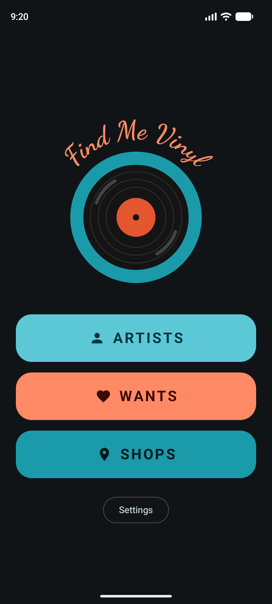
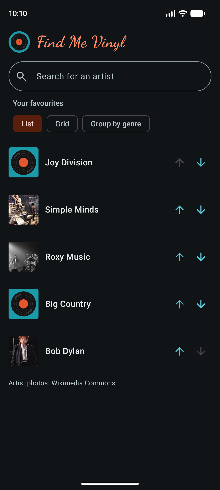
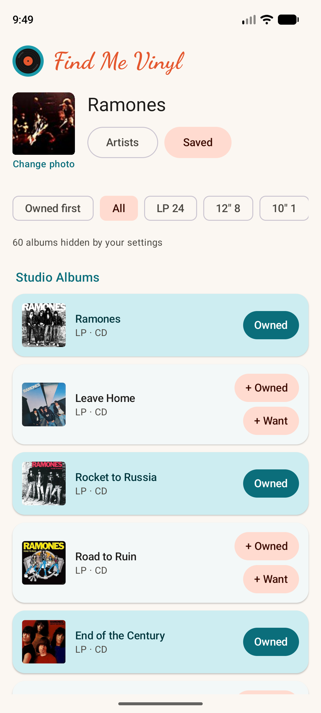
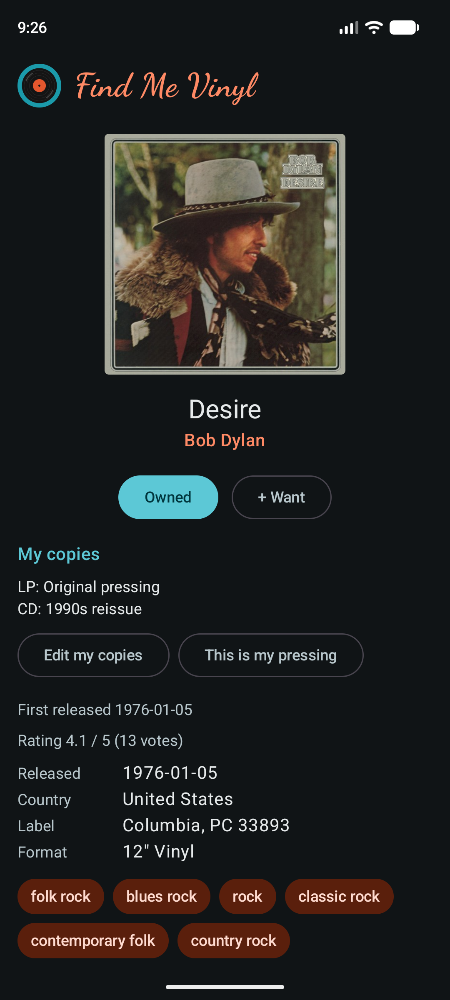
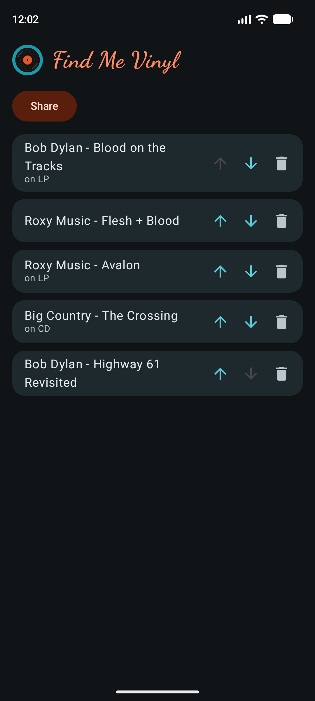
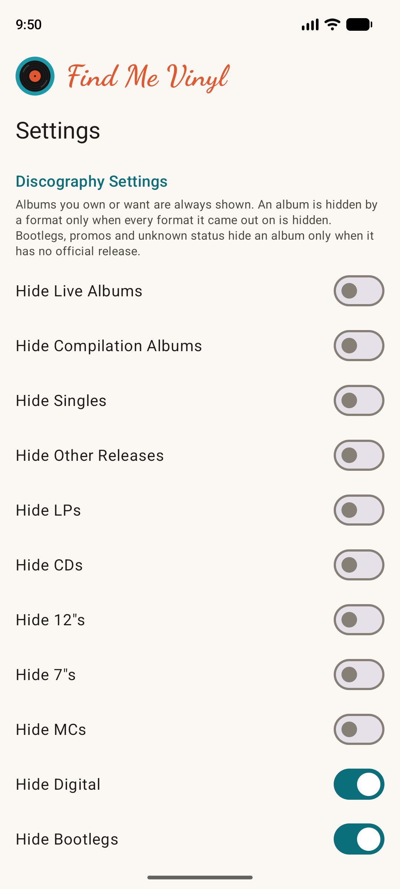

# Find Me Vinyl


An Android app for record collectors. It finds record shops near you, shows an artist's full discography with the formats each album came out on, and keeps your collection and want list on your phone.

It is a hobby project. It has no accounts, no adverts and no server of its own. Everything you choose stays on the phone, and the music data comes from free public sources listed below.

<p>
  
  
  
  
</p>
<p>
  
  
</p>

## What it does

- Search for an artist and see their whole discography, grouped into studio albums, EPs, singles, live albums, compilations and others, with a cover for each.
- See which formats each album came out on (LP, 12", 7", CD, cassette, digital), and filter by one.
- Mark albums as owned or wanted. Owned albums are teal and wanted ones are orange. The Owned first switch groups what you own at the top, and the app remembers it for each artist.
- Open an album for its pressings, label and catalogue numbers, tracklist by side, genres and rating.
- Keep a list of favourite artists and a want list in the order you choose, and share the want list as text.
- Add your own photo for an artist when the one from the web is poor or missing.
- Find record shops, charity shops and second hand shops near you or in a town you type, with their opening hours and whether they are open now, taking public holidays into account.
- Hide what you do not want to see: live albums, compilations, singles, particular formats, bootlegs, promos, releases with an unknown status, charity shops and second-hand shops.
- Back up your data to a zip file and restore it later, for example on a new phone.

Not captured in the pictures above: the Shops page, because the shared map server was too busy when they were taken.

## Where the data comes from

The app talks to these public services. None needs an account or a key. They are shared and free, so the app keeps its requests few, sends a User-Agent that says what it is, and waits between requests.

| Service | What the app uses it for |
| --- | --- |
| [MusicBrainz](https://musicbrainz.org) | Artist search, discographies, the formats, status, label and release date of each release, tracklists, genres, ratings, and the link to an artist's Wikidata item. It asks for about one request a second, and the app stays under that. Its User-Agent includes a contact address, which MusicBrainz asks for. |
| [Cover Art Archive](https://coverartarchive.org) | The cover of each album, by MusicBrainz id. |
| [Wikidata](https://www.wikidata.org) and [Wikimedia Commons](https://commons.wikimedia.org) | The picture of an artist. MusicBrainz gives the Wikidata item, Wikidata gives the file name of the picture, and Commons serves it. The app never matches an artist to a picture by name. The photos are credited on the screens that show them. |
| [Nominatim](https://nominatim.openstreetmap.org) (OpenStreetMap) | Turns a town name into a position, and a position into a region, which decides which public holidays apply. |
| [Overpass API](https://wiki.openstreetmap.org/wiki/Overpass_API) (OpenStreetMap) | The shops: record, music, charity and second hand shops around a position, with their names and opening hours. The app asks the server of [OpenStreetMap France](https://overpass.openstreetmap.fr) first, and [overpass-api.de](https://overpass-api.de) if that fails or is slow. The data is the work of OpenStreetMap contributors. |
| [Nager.Date](https://date.nager.at) | Public holidays by country and year, used to judge whether a shop is open on a bank holiday. Only a country code and a year are sent. |
| Google Play services location | The phone's position, for the Near me search. This is a library on the phone, not a web service. |

Answers are kept on the phone for a while (formats for 30 days, album pages and artist pictures for 90 days, holidays for 90 days), so reopening an artist costs few or no requests.

## Privacy

The app has no analytics and no server of its own. Your favourites, owned and wanted albums, photos and settings are stored on the phone only, and leave it only when you make a backup or share the want list. Your position is used when you search for shops: it is sent to the OpenStreetMap services above to find them. It is not stored anywhere else.

## Building it

You need Android Studio and the Android SDK. Gradle has to run on JDK 21: with a newer JDK the tests fail with "Unsupported class file major version".

1. Clone the repository and open it in Android Studio.
2. Add a line to `local.properties` (the file Android Studio creates; it is not committed) with your own contact address:

   ```
   musicbrainz.contact.email=you@example.com
   ```

   MusicBrainz asks every app to identify itself. The address goes into the User-Agent header of requests to MusicBrainz and nowhere else. Use your own, and do not commit it.
3. Run the app on a device or emulator (Android 8.0 or newer), or build it from the command line:

   ```
   ./gradlew assembleDebug
   ```

4. Run the tests:

   ```
   ./gradlew testDebugUnitTest
   ```

   About 1100 tests run on the JVM with no device, using Robolectric for the screens and a local mock server for the network.

The app is written in Kotlin with Jetpack Compose, Room for storage, Retrofit and OkHttp for the network.

## Contributing

Contributions are welcome, whether that is a bug report, an idea, a fix or a feature.

- For anything bigger than a small fix, open an issue first so we can agree on the approach before you spend time on it.
- Fork the repository and make one branch for each change, from an up to date `master`.
- Write the test first, see it fail for the right reason, then write the code. Every change comes with tests, and the whole suite must pass: `./gradlew testDebugUnitTest`.
- Keep a pull request small and about one thing, with a short description of what changed and why.
- Please ask before adding a library or changing a version. Several versions are pinned because newer ones broke the build, and the reasons are in `CLAUDE.md`.
- Be kind to the public services. Keep requests few, keep the User-Agent, and do not add anything that makes many requests at once. Read the notes on rate limits in `CLAUDE.md` before changing how requests are made.
- A change to a database table needs a version bump and a migration, so nobody loses their collection when the app updates.
- Never commit `local.properties`, keys or addresses.
- By contributing, you agree that your contribution is released under the MIT licence below.

The conventions of the code, and the problems already met and solved, are written down in [`CLAUDE.md`](CLAUDE.md). It is the best place to start reading. The list of known gaps at the end of it is a good source of things to improve.

The continuous integration check (unit tests on JDK 21) runs on every pull request and has to pass before a change is merged.

## Licence

The code is released under the [MIT licence](LICENSE).

The licence covers the code and the text of this repository. It does not cover what the app shows. Album covers, artist photos and music data belong to their owners and sources, including the ones in the screenshots above:

- Album covers come from the Cover Art Archive, and each cover is the property of its rightsholder.
- Artist photos come from Wikimedia Commons, each under its own licence, and are credited in the app.
- Music data comes from MusicBrainz, whose core data is public domain (CC0).
- Shop data is by OpenStreetMap contributors, under the Open Database Licence.

## How it is built

Most of the code was written with Claude Code, Anthropic's coding assistant, in small test-first steps, under the direction of the author, who merges every change. `CLAUDE.md` is the set of rules it follows, and it is as useful to a human contributor.
